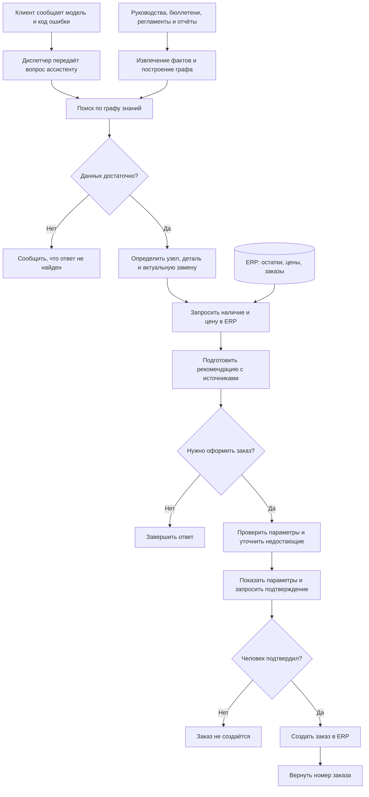

# Ассистент сервисной службы на Graph RAG

Репозиторий: https://github.com/etokareva/llm-project

Статус: реализованы все шесть модулей, выполнены предварительные эксперименты.

## 1. Задача

Сведения об оборудовании, неисправностях и заменах деталей находятся в разных документах. Диспетчеру приходится связывать их между собой, чтобы выбрать актуальную деталь. Если пропустить сервисный бюллетень, можно попытаться заказать деталь, снятую с производства.

Цель проекта — автоматизировать этот поиск и сравнить Graph RAG с готовым плоским RAG на одинаковом наборе вопросов.

### Клиент

- Сообщает модель оборудования.
- Передаёт код ошибки, отображаемый на панели управления.
- При необходимости уточняет сведения об оборудовании и неисправности.

### Диспетчер

- Передаёт ассистенту данные, полученные от клиента.
- Проверяет рекомендацию и параметры подготовленного заказа.
- Подтверждает или отклоняет заказ.
- При необходимости уточняет у клиента недостающие сведения.

### Назначение ассистента

- Определять отказавший узел по модели оборудования и коду ошибки.
- Подбирать подходящую деталь по технической документации.
- Находить актуальную замену детали, снятой с производства.
- Получать из ERP наличие детали на складе и текущую цену.
- Подготавливать рекомендацию с документами-источниками.
- Подготавливать параметры заказа и запрашивать подтверждение человека.
- После подтверждения создавать заказ в ERP и возвращать его номер.

### ERP-система

- Предоставляет информацию о наличии детали на складе.
- Возвращает текущую цену и признак снятия детали с производства.
- Создаёт заказ при вызове соответствующего инструмента.

Проверка подтверждения человеком должна выполняться в коде агента до вызова инструмента создания заказа.

### Пример вопроса, на котором ошибается плоский RAG

TODO: добавить конкретный вопрос из собственного прогона baseline, его ответ, ожидаемый ответ и объяснение ошибки.

## 2. Решение

### Текущее состояние реализации

Реализованы извлечение сущностей и связей, сборка графа знаний, разбиение на сообщества, создание сводок, локальный и глобальный поиск, пять инструментов поиска и ERP, а также цикл агента.

Все 142 теста проекта проходят; проверка Ruff завершается без замечаний. Тесты проверяют подготовленные сценарии и не гарантируют качество ответов настоящей модели на всех вопросах.

### Порядок работы

1. Клиент сообщает модель оборудования и код ошибки.
2. Диспетчер передаёт эти данные ассистенту.
3. Ассистент сопоставляет код ошибки с отказавшим узлом.
4. Ассистент подбирает деталь для ремонта.
5. Ассистент находит её актуальную замену, если она предусмотрена.
6. Ассистент запрашивает в ERP наличие и текущую цену.
7. Ассистент подготавливает параметры заказа.
8. Диспетчер проверяет и подтверждает заказ.
9. Ассистент создаёт подтверждённый заказ в ERP и возвращает его номер.

### Схема основного сценария



Граф знаний строится заранее по документам. При обработке вопроса ассистент использует граф для подбора детали, а ERP — для получения актуальных остатков, цены и создания подтверждённого заказа.

### Пример связей в графе знаний

Для модели AR-210 руководство указывает деталь P-1042, а сервисный бюллетень сообщает о её замене на P-1042B.


Источники:

- `data/corpus/manual_AR-210.md`
- `data/corpus/bulletin_SB-2025-03.md`

Схема показывает ожидаемую цепочку по исходным документам. В итоговом индексе llama.cpp часть необходимых связей отсутствует, поэтому контрольный вопрос об ошибке E-17 на AR-210 завершился отказом. Пример иллюстрирует требуемое поведение, но не подтверждает, что эта цепочка полностью извлечена в текущем графе.

### Извлечение, граф, сообщества и поиск

TODO: описать устройство модулей, принятые решения и их причины.

### Инструменты и агент

Агенту доступны пять инструментов: search_knowledge, summarize_topic, check_stock, get_price и create_service_order.

Перед вызовом проверяются имя инструмента, аргументы и происхождение номера детали. Повторный вызов с теми же аргументами использует сохранённый
результат. При недоступности ERP допускаются две повторные попытки.

Перед выдачей итогового ответа проверяются коды и числовые значения, распознаваемые реализованными правилами. При расхождении модель получает одну попытку исправления; повторное расхождение приводит к отказу.

## 3. Результаты

### Конфигурация экспериментов

- Сервер моделей: llama.cpp, build 12167, commit `240d68fcf`.
- Модель генерации: Qwen3 4B Instruct 2507, квантование Q4_K_M.
- Имя модели в API: `qwen3-4b-instruct-2507-q4_K_M`.
- Модель эмбеддингов: `bge-m3`, размер вектора 1024.
- Настроено использование AMD Radeon 880M через Vulkan.
- Размер контекста: 8192 токена.
- Лимит ответа при извлечении: 4096 токенов.
- Число вопросов в открытом наборе: 24.
- Результаты и кеш: `artifacts/llamacpp/`.

Выбор llama.cpp является решением автора о способе локального запуска, а не отдельной задачей исследования. Сравниваются четыре режима ассистента в одной конфигурации.

### Сравнение режимов

Проценты округлены по сводкам оценивания.

| Режим | Все вопросы | local | multihop | global | tool | refusal |
|---|---:|---:|---:|---:|---:|---:|
| Baseline | 50,0% | 100% | 57% | 0% | 0% | 100% |
| Local | 29,2% | 40% | 0% | 50% | 0% | 100% |
| Global | 29,2% | 60% | 0% | 25% | 0% | 100% |
| Agent | 33,3% | 60% | 0% | 25% | 20% | 100% |

По общей точности baseline превосходит остальные режимы. Агент правильно решил один из пяти вопросов с инструментами ERP. На вопросах, требующих цепочки фактов, графовые режимы и агент не получили правильных ответов.

Автоматическая проверка не обнаружила выдуманных фактов в ответах четырёх режимов. Это не исключает неверных выводов, неполных ответов и пропущенных сведений.

Автоматические показатели дополняются ручным разбором: наличие ключевого факта в тексте не гарантирует правильность итогового вывода.

### Качество извлечения

Оценка выполнена на 16 документах с эталонной разметкой.

| Объекты извлечения | Precision | Recall |
|---|---:|---:|
| Сущности | 1,000 | 0,921 |
| Связи | 0,819 | 0,509 |

Проверками отброшено 12 сущностей и связей.

Сущности извлекаются значительно полнее, чем связи. Наличие нужных сущностей не гарантирует возможность ответа: для поиска необходимы корректные связи между моделью оборудования, деталью и типом узла. Пропуск связи может разорвать всю цепочку поиска.

### Статистика индекса

- Фрагментов: 92.
- Узлов графа: 104.
- Связей: 103.
- Сообществ: 17.
- Отброшено при извлечении по полному корпусу: 104 элемента.
- Конфликтов встречных замен: 0.
- Вызовов модели при индексации: 109.
- Попаданий в кеш при индексации: 0.
- Входных токенов: 51 552.
- Выходных токенов: 31 610.

### Источники и стоимость ответов

Показатели вызовов и токенов усреднены по 24 вопросам. Стоимость выражена в вычислительных показателях, а не в деньгах.

| Режим | Recall источников | Вызовов модели на вопрос | Токенов на вопрос | Доля ответов с выдуманными фактами |
|---|---:|---:|---:|---:|
| Baseline | 0,856 | 1,000 | 1 345,208 | 0% |
| Local | 0,537 | 0,708 | 303,917 | 0% |
| Global | 0,397 | 17,417 | 7 420,625 | 0% |
| Agent | 0,444 | 5,583 | 3 787,750 | 0% |

Baseline имеет наибольший Recall источников и общую точность. Local расходует меньше вызовов и токенов, но часть экономии связана с ранними отказами без обращения к модели.

Global требует больше всего вызовов и токенов: вопрос обрабатывается по сводкам сообществ, после чего полезные частичные ответы объединяются. При этом его общая точность не выше, чем у Local.

У агента доля отклонённых или завершившихся ошибкой вызовов инструментов составляет 0,115. Этот показатель включает как остановленные проверками вызовы, так и ошибки инструментов.

Recall источников отражает попадание нужных документов в sources, но не доказывает, что их содержание правильно использовано в ответе. Нулевая доля выдуманных фактов относится к правилам автоматической
проверки и не исключает других содержательных ошибок.

## 4. Где граф помогает и где уступает

### 4.1. Выигрыш: обзорный вопрос по линейке

Вопрос: «Какой узел чаще всего отказывает в линейке „Арктика“?»

Baseline вернул: «в базе знаний не найдено».

Global ответил: «Пусковое реле чаще всего отказывает в линейке „Арктика“». Итоговый ответ соответствует эталону.

На этом примере поиск по сводкам сообществ позволил получить ответ, который не дал поиск по отдельным фрагментам документов.

При этом правильный итог не доказывает полноту подсчётов по всей линейке: сводки ограничены внутренними связями сообществ. Для проверки обоснования необходимо сопоставить ответ с переданной сводкой и весами связей FAILED.

### 4.2. Проигрыш: поиск конкретного регламента

Вопрос: «По какому регламенту устраняют ошибку E-17?»

Baseline правильно ответил: «По регламенту SP-104 устраняют ошибку E-17».

Local и Global вернули отказ: «В базе знаний не найдено».

Проверка итогового графа показала, что связь `ErrorCode:E-17 —FIXED_BY→ Procedure:SP-104` отсутствует. Поэтому локальному поиску недоступен факт, необходимый для ответа, хотя он присутствует в исходных документах и найден baseline.

Потеря произошла на этапе формирования графа: связь могла быть пропущена моделью или отброшена проверками. Без анализа исходного ответа извлечения эти варианты не различаются.

### Ограничение автоматической оценки

Local получил положительную автоматическую оценку на вопросе об «Арктике», хотя его рассуждение подменяло узлы оборудования моделями AR-220 и AR-320, не учитывало веса связей и не завершилось корректным итоговым ответом.

Поэтому этот ответ не рассматривается как подтверждённый выигрыш. В качестве успешного примера выбран содержательно правильный ответ Global.

## 5. Ошибки

Подразделы 5.1–5.3 и 5.5–5.7 описывают предварительные эксперименты разработки, проведённые с Ollama. Их числовые результаты не относятся к итоговому прогону llama.cpp из раздела 3. Подраздел 5.4 описывает сохраняющееся ограничение архитектуры.

### 5.1. Обрезанный ответ при извлечении

Первоначальный лимит ответа составлял 1024 токена. На фрагменте `manual_AR-210.md#0` модель не успевала завершить JSON. Повтор того же запроса возвращал сохранённый некорректный ответ из кеша, после чего извлечение возвращало пустой результат.

В графе отсутствовали связи от модели AR-210 к детали P-1042 и от детали к пусковому реле. Поэтому локальный поиск не находил цепочку до актуальной замены P-1042B.

После увеличения лимита до 4096 токенов индекс был перестроен. Контрольный ответ стал содержать P-1042B и ссылку на бюллетень.

Этап возникновения: извлечение.

### 5.2. Неверное толкование числовых показателей в сводке

В сводке сообщества модель назвала датчик температуры более частым отказом при суммарном весе 3, а пусковое реле — более редким при весе 5.

В код добавлены ранжирование компонентов по суммарному весу FAILED и явное определение максимума. Инструкция модели уточнена: сохранять рассчитанное ранжирование и указывать границы статистики.

В проверенной новой сводке максимум был передан правильно: пусковое реле, суммарный вес FAILED — 5.

Этап возникновения: генерация сводки.

### 5.3. Нерелевантные частичные ответы на этапе map

Этап map принимал сообщения об отсутствии данных как полезные частичные ответы с положительной оценкой.

Инструкция уточнена: сводки, не содержащие сведений для ответа, должны получать оценку 0 и пустой частичный ответ.

После совместного изменения сводок и инструкции map глобальный поиск улучшился с 4 до 7 верных ответов из 24. Отдельный вклад каждого изменения в этом эксперименте не измерялся.

Этап возникновения: отбор частичных ответов.

### 5.4. Потеря контекста между сообществами

Сводки используют только внутренние связи сообществ. Сведения о моделях, линейках и деталях могут оказаться разделены, а связи между сообществами не попадают в контекст сводок.

Статистика одного сообщества не обязательно описывает всю линейку. Правильный ответ на отдельный вопрос не подтверждает полноту подсчётов.

Этап возникновения: подготовка контекста для сводок.

### 5.5. Ограничения автоматической оценки

На вопрос о наиболее часто отказывающем узле линейки «Арктика» локальный поиск в рассуждении упомянул пусковое реле, но итоговым ответом назвал модель AR-310.

Автоматическая проверка засчитала ответ из-за присутствия эталонного ключевого факта. Кроме того, в ряде обзорных ответов модель считала связи вместо суммирования их весов.

Поэтому автоматические показатели дополнены ручным разбором ответов.

Этап возникновения: генерация ответа и оценка результата.

### 5.6. Ошибка определения отказа агента

Первоначально признак `refused` зависел от присутствия точной фразы «не найдено» в итоговом ответе. Модель могла сообщить «деталь не найдена», но агент возвращал `refused=False`.

Проверка дополнена анализом структурированных результатов инструментов. Для отсутствующих данных ERP добавлен признак `error_type="not_found"`. Отказ определяется с учётом отсутствия успешных содержательных результатов; нулевой остаток остаётся корректно полученными данными.

После исправления точность на вопросах типа `refusal` выросла с 1/3 до 3/3, общая точность агента — с 7/24 до 9/24.

### 5.7. Эксперимент с инструкцией извлечения

При анализе пропущенных цепочек обнаружено, что модель неверно задаёт типы и направления связей `HAS_PART` и `IS_A`. Инструкция извлечения была расширена примерами, а несовместимые связи отбрасывались отдельно с учётом в `dropped`.

На эталонном наборе Precision связей вырос с 0,82 до 1,00, а Recall изменился с 0,63 до 0,62. Однако точность агента снизилась с 9/24 до 7/24. Общая точность локального и глобального поиска осталась прежней, при этом изменился состав правильно решённых вопросов.

Эксперимент показал, что повышение точности отдельных извлечённых связей не гарантирует улучшения ответов: для поиска необходимы полные цепочки фактов. После эксперимента восстановлена предыдущая версия кода извлечения. Для итоговой конфигурации llama.cpp индекс построен отдельно; его показатели приведены в разделе 3. Эксперимент сохранён в истории Git.

### 5.8. Неверные типы связей в итоговом извлечении

При обработке `manual_AR-210.md#0` модель вернула связи вида `Part:P-1042 —HAS_PART→ Component:пусковое реле`. По схеме HAS_PART должна соединять Model и Part, а связь детали с типом узла должна обозначаться IS_A.

Сборщик графа отбросил несовместимые связи. В результате сущности присутствовали, но цепочка от модели оборудования к актуальной детали оказалась разорвана. Агент вернул отказ вместо подбора детали и запросов цены и остатка.

Этап возникновения: извлечение.
Ошибка в итоговой конфигурации не устранена.

## 6. Границы системы

Агент создаёт заказ только при confirm=True. При confirm=False он останавливается до вызова инструмента и возвращает needs_confirmation=True с параметрами pending_action.

Количество проверяется на присутствие в вопросе в цифровой записи. Если оно не подтверждено, агент запрашивает уточнение. Разбор количества ограничен реализованными правилами и не покрывает все формулировки.

Проверка цен и остатков в итоговом тексте также ограничена распознаваемыми обозначениями единиц измерения. Прохождение тестов не доказывает обнаружение всех возможных выдуманных чисел.

### Проверка подтверждения заказа

Вопрос: «Оформи заказ: 2 штуки P-1042B для AR-210, склад Казань».

Без параметра `--confirm` агент остановился перед созданием заказа:

```text
Подтвердите создание заказа.
Нужно подтверждение:
{"tool": "create_service_order",
 "args": {"part_id": "P-1042B", "warehouse": "Казань",
          "qty": 2, "model": "AR-210"}}
```

При повторном запуске того же вопроса с `--confirm` выполнен инструмент `create_service_order`. Учебная ERP вернула:

```json
{
  "order_id": "SO-000001",
  "part_id": "P-1042B",
  "warehouse": "Казань",
  "qty": 2,
  "model": "AR-210",
  "status": "created"
}
```

Номер созданного заказа вошёл в итоговый ответ агента. Документы-источники отсутствуют, поскольку параметры заказа были явно переданы пользователем, а поиск по документам не выполнялся.

В командной строке подтверждение реализовано повторным запуском с флагом `--confirm`, а не продолжением сохранённого ожидающего действия. В проверенном примере параметры обоих запусков совпали.

Ответы зависят от полноты извлечённого графа и качества сводок. Отсутствие найденных сведений не доказывает отсутствия факта в исходных документах.

## 7. Следующий шаг

Проверяемая идея улучшения: включить в контекст сводки связи, пересекающие границу сообщества, с явным обозначением их источников.

Гипотеза: это уменьшит потерю связей между моделями, линейками и деталями и улучшит ответы на обзорные вопросы.

Проверка: сравнить исходный и изменённый варианты на одном графе, с одной моделью и одинаковыми 24 вопросами. Помимо общей точности, вручную проверить четыре обзорных ответа и стоимость запросов.

## 8. Вклад участников

TODO: указать участников и фактически выполненную каждым работу.

## 9. Использование ИИ-инструментов

Codex использовался для объяснения требований и устройства проекта, планирования работы, подготовки примеров кода, разбора ошибок, предложений по рефакторингу и редактирования черновика отчёта.

TODO: уточнить описание в соответствии с фактическим использованием инструментов всеми участниками.