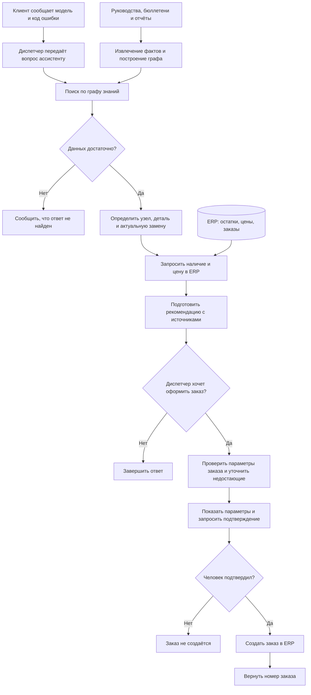
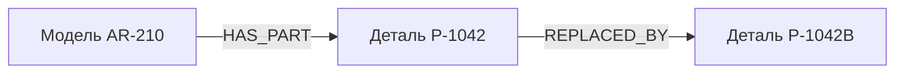

# Ассистент сервисной службы на Graph RAG

Репозиторий: https://github.com/etokareva/llm-project

## 1. Задача

Сведения об оборудовании, неисправностях и заменах деталей находятся
в разных документах. Диспетчеру приходится связывать их между собой,
чтобы выбрать актуальную деталь. Если пропустить сервисный бюллетень,
можно попытаться заказать деталь, снятую с производства.
Цель проекта — автоматизировать этот поиск и сравнить Graph RAG
с готовым плоским RAG на одинаковом наборе вопросов.

### Клиент:

- Сообщает модель оборудования.
- Передаёт код ошибки, отображаемый на панели управления.
- При необходимости уточняет дополнительные сведения об оборудовании и неисправности.

### Ассистент:

- Анализирует модель оборудования и код ошибки.
- Определяет отказавший узел по технической документации.
- Подбирает подходящую деталь для ремонта.
- Проверяет, не снята ли деталь с производства.
- Если деталь снята с производства, определяет актуальную замену.
- Получает из ERP-системы информацию о наличии детали на складе и её текущей цене.
- Собирает сведения в единую рекомендацию.
- Подготавливает параметры заказа на основании найденных данных.
- Запрашивает обязательное подтверждение человека.
- После подтверждения создаёт заказ в ERP и возвращает его номер.

### Диспетчер:

- Предоставляет ассистенту данные, полученные от клиента.
- Проверяет корректность определённого узла, выбранной детали и возможной замены.
- Подтверждает или отклоняет подготовленный заказ.
- При необходимости уточняет у клиента недостающие сведения.

### ERP-система:

- Предоставляет информацию о наличии детали на складе.
- Возвращает текущую цену детали.
- Создаёт заказ по запросу ассистента после подтверждения человеком.

### Порядок работы:

1. Клиент сообщает модель оборудования и код ошибки.
2. Диспетчер передаёт эти данные ассистенту.
3. Ассистент сопоставляет код ошибки с отказавшим узлом.
4. Ассистент подбирает деталь для ремонта.
5. Ассистент проверяет статус детали и при необходимости находит её замену.
6. Ассистент запрашивает в ERP-системе наличие и текущую цену.
7. Ассистент подготавливает параметры заказа.
8. Диспетчер проверяет и подтверждает заказ.
9. Ассистент создаёт подтверждённый заказ в ERP и возвращает его номер.

### Схема работы ассистента

Граф знаний строится заранее по документам. При обработке вопроса
ассистент использует граф для подбора детали, а ERP — для получения
актуальных остатков, цены и создания подтверждённого заказа.

### Пример связей в графе знаний

Для модели AR-210 руководство указывает деталь P-1042,
а сервисный бюллетень сообщает о её замене на P-1042B.

Источники: `data/corpus/manual_AR-210.md` и
`data/corpus/bulletin_SB-2025-03.md`.