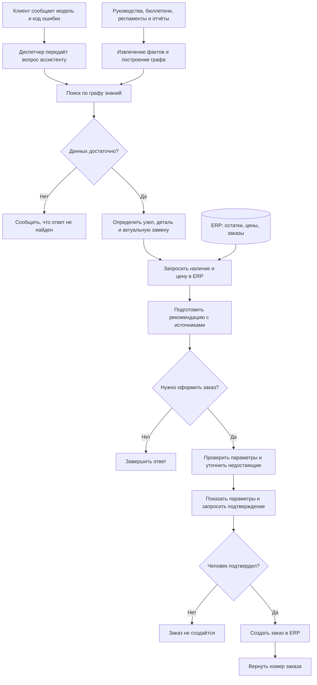

# Ассистент сервисной службы на Graph RAG

Репозиторий: https://github.com/etokareva/llm-project

## 1. Задача

Сведения об оборудовании, неисправностях и заменах деталей находятся
в разных документах. Диспетчеру приходится связывать их между собой,
чтобы выбрать актуальную деталь. Если пропустить сервисный бюллетень,
можно попытаться заказать деталь, снятую с производства.

Цель проекта — автоматизировать этот поиск и сравнить Graph RAG
с готовым плоским RAG на одинаковом наборе вопросов.

### Клиент

- Сообщает модель оборудования.
- Передаёт код ошибки, отображаемый на панели управления.
- При необходимости уточняет сведения об оборудовании и неисправности.

### Диспетчер

- Передаёт ассистенту данные, полученные от клиента.
- Проверяет рекомендацию и параметры подготовленного заказа.
- Подтверждает или отклоняет заказ.
- При необходимости уточняет у клиента недостающие сведения.

### Планируемые возможности ассистента

- Определять отказавший узел по модели оборудования и коду ошибки.
- Подбирать подходящую деталь по технической документации.
- Находить актуальную замену детали, снятой с производства.
- Получать из ERP наличие детали на складе и текущую цену.
- Подготавливать рекомендацию с документами-источниками.
- Подготавливать параметры заказа и запрашивать подтверждение человека.
- После подтверждения создавать заказ в ERP и возвращать его номер.

### ERP-система

- Предоставляет информацию о наличии детали на складе.
- Возвращает текущую цену и признак снятия детали с производства.
- Создаёт заказ при вызове соответствующего инструмента.

Проверка подтверждения человеком должна выполняться в коде агента
до вызова инструмента создания заказа.

### Пример вопроса, на котором ошибается плоский RAG

TODO: добавить конкретный вопрос из собственного прогона baseline,
его ответ, ожидаемый ответ и объяснение ошибки.

## 2. Решение

### Текущее состояние реализации

Реализованы извлечение сущностей и связей, сборка графа знаний,
разбиение на сообщества, создание сводок, локальный и глобальный поиск.

Инструменты ERP и цикл агента пока не реализованы.

### Планируемый порядок работы

1. Клиент сообщает модель оборудования и код ошибки.
2. Диспетчер передаёт эти данные ассистенту.
3. Ассистент сопоставляет код ошибки с отказавшим узлом.
4. Ассистент подбирает деталь для ремонта.
5. Ассистент находит её актуальную замену, если она предусмотрена.
6. Ассистент запрашивает в ERP наличие и текущую цену.
7. Ассистент подготавливает параметры заказа.
8. Диспетчер проверяет и подтверждает заказ.
9. Ассистент создаёт подтверждённый заказ в ERP и возвращает его номер.

### Планируемая схема работы ассистента

Граф знаний строится заранее по документам. При обработке вопроса
ассистент использует граф для подбора детали, а ERP — для получения
актуальных остатков, цены и создания подтверждённого заказа.

### Пример связей в графе знаний

Для модели AR-210 руководство указывает деталь P-1042,
а сервисный бюллетень сообщает о её замене на P-1042B.

Источники:

- `data/corpus/manual_AR-210.md`
- `data/corpus/bulletin_SB-2025-03.md`

После увеличения лимита ответа при извлечении локальный поиск
на контрольный вопрос об ошибке E-17 на AR-210 вернул P-1042B
и указал сервисный бюллетень среди источников.

### Извлечение, граф, сообщества и поиск

TODO: описать устройство модулей, принятые решения и их причины.

### Инструменты и агент

TODO: заполнить после реализации.

## 3. Результаты

### Конфигурация экспериментов

- Модель генерации: `qwen3:4b-instruct-2507-q4_K_M`.
- Модель эмбеддингов: `bge-m3`.
- Сервер моделей в проведённых прогонах: Ollama.
- Число вопросов в открытом наборе: 24.
- Лимит ответа при извлечении после исправления: 4096 токенов.

### Предварительное сравнение режимов

Проценты округлены по сводкам оценивания.

| Режим | Все вопросы | local | multihop | global | tool | refusal |
|---|---:|---:|---:|---:|---:|---:|
| Baseline | 50% | 100% | 57% | 0% | 0% | 100% |
| Local | 38% | 40% | 14% | 75% | 0% | 100% |
| Global после улучшений | 29% | 60% | 0% | 25% | 0% | 100% |
| Agent | — | — | — | — | — | — |

Эти показатели отражают автоматическую проверку наличия ключевых
фактов. Они не заменяют ручную оценку правильности итогового вывода.

### Изменение результатов глобального поиска

| Показатель | До изменений | После изменений |
|---|---:|---:|
| Верных ответов на всех вопросах | 4 из 24 | 7 из 24 |
| Верных ответов на обзорных вопросах | 0 из 4 | 1 из 4 |
| Вызовов модели на вопрос | 14,9 | 14,3 |

### Качество извлечения

На эталонном наборе из 16 документов:

- Precision связей: 0,82.
- Recall связей: 0,63.
- Отброшено проверками: 22 сущности и связи.

TODO: добавить Precision и Recall сущностей из `eval_extraction.json`.

### Статистика индекса

- Фрагментов: 92.
- Узлов графа: 108.
- Связей: 136.
- Сообществ: 14.
- Отброшено при извлечении по полному корпусу: 76 элементов.
- Конфликтов встречных замен: 0.

TODO: добавить стоимость индексации в вызовах и токенах,
Recall источников и стоимость каждого режима из итоговых файлов оценивания.

## 4. Где граф помогает и где уступает

TODO: разобрать два примера по собственным прогонам.
Для каждого привести вопрос, ответы сравниваемых режимов,
использованные факты и объяснение результата.

## 5. Ошибки

### 5.1. Обрезанный ответ при извлечении

Первоначальный лимит ответа составлял 1024 токена.
На фрагменте `manual_AR-210.md#0` модель не успевала завершить JSON.
Повтор того же запроса возвращал сохранённый некорректный ответ из кеша,
после чего извлечение возвращало пустой результат.

В графе отсутствовали связи от модели AR-210 к детали P-1042
и от детали к пусковому реле. Поэтому локальный поиск не находил
цепочку до актуальной замены P-1042B.

После увеличения лимита до 4096 токенов индекс был перестроен.
Контрольный ответ стал содержать P-1042B и ссылку на бюллетень.

Этап возникновения: извлечение.

### 5.2. Неверное толкование числовых показателей в сводке

В сводке сообщества модель назвала датчик температуры более частым
отказом при суммарном весе 3, а пусковое реле — более редким при весе 5.

В код добавлены ранжирование компонентов по суммарному весу FAILED
и явное определение максимума. Инструкция модели уточнена:
сохранять рассчитанное ранжирование и указывать границы статистики.

В проверенной новой сводке максимум был передан правильно:
пусковое реле, суммарный вес FAILED — 5.

Этап возникновения: генерация сводки.

### 5.3. Нерелевантные частичные ответы на этапе map

Этап map принимал сообщения об отсутствии данных как полезные
частичные ответы с положительной оценкой.

Инструкция уточнена: сводки, не содержащие сведений для ответа,
должны получать оценку 0 и пустой частичный ответ.

После совместного изменения сводок и инструкции map глобальный поиск
улучшился с 4 до 7 верных ответов из 24. Отдельный вклад каждого
изменения в этом эксперименте не измерялся.

Этап возникновения: отбор частичных ответов.

### 5.4. Потеря контекста между сообществами

Сводки используют только внутренние связи сообществ.
Сведения о моделях, линейках и деталях могут оказаться разделены,
а связи между сообществами не попадают в контекст сводок.

Статистика одного сообщества не обязательно описывает всю линейку.
Правильный ответ на отдельный вопрос не подтверждает полноту подсчётов.

Этап возникновения: подготовка контекста для сводок.

### 5.5. Ограничения автоматической оценки

На вопрос о наиболее часто отказывающем узле линейки «Арктика»
локальный поиск в рассуждении упомянул пусковое реле,
но итоговым ответом назвал модель AR-310.

Автоматическая проверка засчитала ответ из-за присутствия
эталонного ключевого факта. Кроме того, в ряде обзорных ответов
модель считала связи вместо суммирования их весов.

Поэтому автоматические показатели дополнены ручным разбором ответов.

Этап возникновения: генерация ответа и оценка результата.

## 6. Границы системы

Создание заказа должно выполняться только после подтверждения человека.
До подтверждения ассистент должен возвращать подготовленные параметры,
не вызывая создание заказа в ERP.

TODO: после реализации описать проверки в коде,
обработку недостающих параметров и показать пример подтверждения.

Ответы зависят от полноты извлечённого графа и качества сводок.
Отсутствие найденных сведений не доказывает отсутствия факта
в исходных документах.

## 7. Следующий шаг

Проверяемая идея улучшения: включить в контекст сводки связи,
пересекающие границу сообщества, с явным обозначением их источников.

Гипотеза: это уменьшит потерю связей между моделями, линейками
и деталями и улучшит ответы на обзорные вопросы.

Проверка: сравнить исходный и изменённый варианты на одном графе,
с одной моделью и одинаковыми 24 вопросами. Помимо общей точности,
вручную проверить четыре обзорных ответа и стоимость запросов.

## 8. Вклад участников

TODO: указать участников и фактически выполненную каждым работу.

## 9. Использование ИИ-инструментов

Codex использовался для объяснения требований и устройства проекта,
планирования работы, подготовки примеров кода, разбора ошибок,
предложений по рефакторингу и редактирования черновика отчёта.

TODO: уточнить описание в соответствии с фактическим использованием
инструментов всеми участниками.