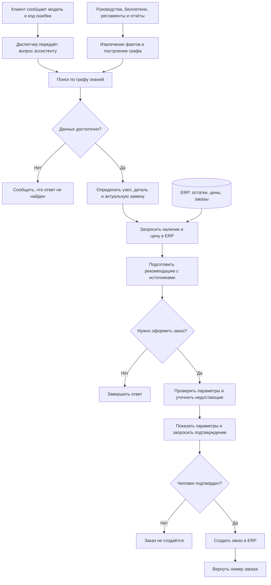

# Ассистент сервисной службы на Graph RAG

Репозиторий: [etokareva/llm-project](https://github.com/etokareva/llm-project)

Статус: реализованы все шесть модулей, выполнены тестирование и оценка качества на открытом наборе вопросов.

## 1. Задача

Сведения об оборудовании, неисправностях и заменах деталей находятся в разных документах. Диспетчеру приходится связывать их между собой, чтобы выбрать актуальную деталь. Если пропустить сервисный бюллетень, можно попытаться заказать деталь, снятую с производства.

Цель проекта — автоматизировать этот поиск и сравнить Graph RAG с готовым плоским RAG на одинаковом наборе вопросов.

### Клиент

- Сообщает модель оборудования.
- Передаёт код ошибки, отображаемый на панели управления.
- При необходимости уточняет сведения об оборудовании и неисправности.

### Диспетчер

- Передаёт ассистенту данные, полученные от клиента.
- Проверяет рекомендацию и параметры подготовленного заказа.
- Подтверждает или отклоняет заказ.
- При необходимости уточняет у клиента недостающие сведения.

### Назначение ассистента

- Определять отказавший узел по модели оборудования и коду ошибки.
- Подбирать подходящую деталь по технической документации.
- Находить актуальную замену детали.
- Получать из ERP наличие детали на складе и текущую цену.
- Подготавливать рекомендацию с документами-источниками.
- Подготавливать параметры заказа и запрашивать подтверждение человека.
- После подтверждения создавать заказ в ERP и возвращать его номер.

### ERP-система

- Предоставляет информацию о наличии детали на складе.
- Возвращает текущую цену и признак снятия детали с производства.
- Создаёт заказ при вызове соответствующего инструмента.

Подтверждение человеком проверяется в коде агента до вызова инструмента создания заказа.

### Пример вопроса, на котором ошибается плоский RAG

Вопрос: «Какой узел чаще всего отказывает в линейке „Арктика“?»

В проверенном прогоне baseline ответил: «В базе знаний не найдено». Эталонный ответ — «пусковое реле».

Для ответа необходимо объединить сведения о принадлежности моделей к линейке и об отказах узлов. Поиск отдельных фрагментов не обеспечил достаточного контекста для итогового ответа. Этот пример и ограничения его интерпретации рассмотрены в разделе 4.

## 2. Решение

### Текущее состояние реализации

Реализованы извлечение сущностей и связей, сборка графа знаний, разбиение на сообщества, создание сводок, локальный и глобальный поиск, пять инструментов поиска и ERP, а также цикл агента.

После рефакторинга проходят все 182 теста проекта; проверка Ruff завершается без замечаний. Тесты проверяют подготовленные сценарии и не гарантируют качество ответов настоящей модели на всех вопросах.

### Порядок работы

1. Клиент сообщает модель оборудования и код ошибки.
2. Диспетчер передаёт эти данные ассистенту.
3. Ассистент сопоставляет код ошибки с отказавшим узлом.
4. Ассистент подбирает деталь для ремонта.
5. Ассистент находит её актуальную замену, если она предусмотрена.
6. Ассистент запрашивает в ERP наличие и текущую цену.
7. Ассистент подготавливает параметры заказа.
8. Диспетчер проверяет и подтверждает заказ.
9. Ассистент создаёт подтверждённый заказ в ERP и возвращает его номер.

### Схема основного сценария



Граф знаний строится заранее по документам. При обработке вопроса ассистент использует граф для подбора детали, а ERP — для получения актуальных остатков, цены и создания подтверждённого заказа.

### Пример связей в графе знаний

Для модели AR-210 руководство указывает деталь P-1042, а сервисный бюллетень сообщает о её замене на P-1042B.


Источники:

- `data/corpus/manual_AR-210.md`
- `data/corpus/bulletin_SB-2025-03.md`

Схема показывает ожидаемую цепочку по исходным документам. В итоговом индексе llama.cpp часть необходимых связей отсутствует, поэтому контрольный вопрос об ошибке E-17 на AR-210 завершился отказом. Пример иллюстрирует требуемое поведение, но не подтверждает, что эта цепочка полностью извлечена в текущем графе.

### Извлечение сущностей и связей

Модуль `extraction.py` передаёт модели текст фрагмента, допустимые типы сущностей и связей, а также схему JSON-ответа. Проверка структуры ответа отделена от проверки соответствия фактов исходному тексту.

Коды нормализуются и проверяются на присутствие во фрагменте. Названия сверяются со словарём проекта. Некорректные элементы отбрасываются с учётом в показателе `dropped`.

При ошибке разбора или структуры ответа запрос повторяется один раз. Если оба ответа некорректны, возвращается пустой результат. Это позволяет продолжить индексацию остальных документов, но может привести к потере фактов.

### Сборка графа

Модуль `graph_builder.py` объединяет результаты извлечения в направленный граф NetworkX.

Сущности объединяются по идентификатору, составленному из типа и имени. Для узлов и связей сохраняются источники — идентификаторы фрагментов документов.

Вес связи равен числу разных фрагментов, в которых она найдена. Повтор одной связи внутри фрагмента не увеличивает её вес.

Связи, несовместимые со схемой, отбрасываются. Для встречных связей `REPLACED_BY` сохраняется направление с большим весом; при равных весах удаляются оба направления. Число конфликтующих пар записывается в свойства графа.

### Сообщества и сводки

Модуль `communities.py` снимает направление рёбер и разбивает граф алгоритмом Лувена с фиксированным `seed`. Это обеспечивает воспроизводимость разбиения для одинакового графа.

Для каждого сообщества формируется контекст из сущностей, внутренних связей и рассчитанных показателей. Статистика отказов вычисляется кодом по весам связей `FAILED`, затем передаётся модели для словесного описания.

Сводка ограничивается 150 словами. Такой подход уменьшает объём контекста глобального поиска, но может потерять сведения, связывающие разные сообщества.

### Локальный поиск

Модуль `search.py` определяет исходные сущности по кодам и названиям в вопросе. При неизвестном коде возвращается отказ без обращения к модели.

Для нескольких исходных сущностей отбираются пути длиной до трёх рёбер без учёта направления обхода. Для одной сущности используется окрестность радиуса два. Дополнительно учитываются цепочки замен деталей.

Отобранные факты нумеруются и передаются модели вместе с источниками. Объём текстового контекста ограничен 8000 символами.

### Глобальный поиск

Глобальный поиск обрабатывает сводки сообществ в два этапа:

1. На этапе `map` модель формирует частичный ответ и оценку его полезности для каждой сводки.
2. На этапе `reduce` полезные частичные ответы объединяются в итоговый ответ.

Некорректные ответы и результаты с нулевой оценкой пропускаются. Если полезных сведений нет, система возвращает отказ.

Этот режим предназначен для вопросов, требующих обобщения, но увеличивает число обращений к модели.

### Инструменты и агент

Агенту доступны пять инструментов:

- `search_knowledge` — локальный поиск по графу.
- `summarize_topic` — глобальный поиск по сводкам.
- `check_stock` — проверка остатка детали.
- `get_price` — получение цены детали.
- `create_service_order` — создание сервисного заказа.

Функции инструментов объявлены отдельно, а зависимости связываются при построении словаря инструментов с помощью `functools.partial`.

Цикл агента отделён от вспомогательной проверки аргументов и итогового ответа. Перед вызовом проверяются имя инструмента, структура аргументов и происхождение номера детали. Повторный вызов с теми же аргументами использует сохранённый результат.

При недоступности ERP допускаются две повторные попытки после первого обращения. Отсутствие данных и отклонение запроса ERP обрабатываются отдельно от временной недоступности.

Перед выдачей итогового ответа проверяются коды и числовые значения, распознаваемые реализованными правилами. При расхождении модель получает одну попытку исправления; повторное расхождение приводит к отказу.

Создание заказа требует явного разрешения через параметр `confirm`.

## 3. Результаты

### Конфигурация экспериментов

- Сервер моделей: llama.cpp, build 12167, commit `240d68fcf`.
- Модель генерации: Qwen3 4B Instruct 2507, квантование Q4_K_M.
- Имя модели в API: `qwen3-4b-instruct-2507-q4_K_M`.
- Модель эмбеддингов: `bge-m3`, размер вектора 1024.
- Настроено использование AMD Radeon 880M через Vulkan.
- Размер контекста: 8192 токена.
- Лимит ответа при извлечении: 4096 токенов.
- Число вопросов в открытом наборе: 24.
- Результаты и кеш эксперимента: `artifacts/llamacpp/`.

Выбор llama.cpp является решением автора о способе локального запуска, а не отдельной задачей исследования. Сравниваются четыре режима ассистента в одной конфигурации.

### Сравнение режимов

В таблице указана доля правильных ответов по автоматической оценке. Все значения представлены в процентах.

В набор входят 5 локальных вопросов, 7 вопросов на цепочки фактов, 4 обзорных вопроса, 5 вопросов с инструментами и 3 вопроса на отказ.

| Режим | Все вопросы, % | Локальные, % | Цепочки фактов, % | Обзорные, % | Инструменты, % | Отказы, % |
|---|---:|---:|---:|---:|---:|---:|
| Baseline | 50,0 | 100,0 | 57,1 | 0,0 | 0,0 | 100,0 |
| Local | 25,0 | 40,0 | 0,0 | 25,0 | 0,0 | 100,0 |
| Global | 29,2 | 60,0 | 0,0 | 25,0 | 0,0 | 100,0 |
| Agent | 33,3 | 60,0 | 0,0 | 25,0 | 20,0 | 100,0 |

Baseline правильно ответил на 12 из 24 вопросов, Local — на 6, Global — на 7, Agent — на 8.

По общей точности baseline превосходит остальные режимы. Агент правильно решил один из пяти вопросов с инструментами ERP. На вопросах, требующих цепочки фактов, графовые режимы и агент не получили правильных ответов.

Все режимы правильно обработали три вопроса, требующих отказа. Это результат на конкретном небольшом наборе, а не гарантия правильного отказа на любом запросе.

Автоматическая проверка не обнаружила выдуманных фактов в ответах четырёх режимов. Это не исключает неверных выводов, неполных ответов и пропущенных сведений.

Автоматические показатели дополняются ручным разбором: наличие ключевого факта в тексте не гарантирует правильность итогового вывода.

### Качество извлечения

Оценка выполнена на 16 документах с эталонной разметкой.

| Объекты извлечения | Точность (Precision), % | Полнота (Recall), % |
|---|---:|---:|
| Сущности | 100,0 | 92,1 |
| Связи | 81,9 | 50,9 |

Precision показывает, какая доля извлечённых элементов соответствует эталону. Recall показывает, какая доля эталонных элементов найдена.

Проверками отброшено 12 элементов извлечения на этом наборе.

Сущности извлекаются значительно полнее, чем связи. Наличие нужных сущностей не гарантирует возможность ответа: для поиска необходимы корректные связи между моделью оборудования, деталью и типом узла. Пропуск связи может разорвать всю цепочку поиска.

### Статистика индекса

- Фрагментов: 92.
- Узлов графа: 104.
- Связей: 103.
- Сообществ: 17.
- Отброшено при извлечении по полному корпусу: 104 элемента.
- Конфликтов встречных замен: 0.
- Обращений к клиенту модели при повторной индексации: 109.
- Попаданий в кеш: 109.
- Учтено входных токенов: 51 552.
- Учтено выходных токенов: 31 610.

При последнем повторном запуске все 109 обращений обслужены из кеша. Счётчики токенов включают сохранённые данные ответов и не означают, что эти токены были заново сгенерированы при повторной индексации.

### Полнота источников и вычислительные затраты

Полнота источников и доля ответов с обнаруженными выдуманными фактами представлены в процентах. Число вызовов и число токенов — средние количества на один вопрос.

| Режим | Полнота источников (Recall), % | Вызовов модели на вопрос, среднее | Токенов на вопрос, среднее | Ответов с обнаруженными выдуманными фактами, % |
|---|---:|---:|---:|---:|
| Baseline | 85,6 | 1,00 | 1 345 | 0 |
| Local | 53,7 | 0,71 | 304 | 0 |
| Global | 39,7 | 17,42 | 7 421 | 0 |
| Agent | 44,4 | 5,42 | 3 509 | 0 |

Recall источников показывает долю найденных эталонных групп документов: группа считается найденной, если хотя бы один её документ указан в источниках ответа. Показатель усредняется по вопросам, для которых определены эталонные источники.

Вызовы модели и токены усреднены по 24 вопросам. Токены включают входной запрос и выходной ответ. Поэтому среднее число вызовов может быть дробным: например, часть вопросов Local завершается отказом без обращения к модели.

Эти показатели характеризуют объём запросов и ответов. Они не являются измерением времени выполнения или денежной стоимости; использование кеша также влияет на фактические затраты повторных запусков.

Baseline имеет наибольшую полноту источников и общую точность. Local использует меньше вызовов и токенов, но часть экономии связана с ранними отказами без обращения к модели.

Global требует больше всего вызовов и токенов: вопрос обрабатывается по сводкам сообществ, после чего полезные частичные ответы объединяются. Его общая точность составляет 29,2%, у Local — 25,0%.

У агента доля отклонённых или завершившихся ошибкой вызовов инструментов составляет 8,7%. Этот показатель включает как остановленные проверками вызовы, так и ошибки инструментов.

Наличие нужных документов в источниках не доказывает, что их содержание правильно использовано в ответе. Значение 0% в последнем столбце означает, что реализованная автоматическая проверка не обнаружила выдуманных фактов; другие содержательные ошибки возможны.

## 4. Где граф помогает и где уступает

### 4.1. Выигрыш: обзорный вопрос по линейке

Вопрос: «Какой узел чаще всего отказывает в линейке „Арктика“?»

Baseline вернул: «В базе знаний не найдено».

Global ответил: «Пусковое реле чаще всего отказывает в линейке „Арктика“». Итоговый ответ соответствует эталону.

На этом примере поиск по сводкам сообществ позволил получить ответ, который не дал поиск по отдельным фрагментам документов.

При этом правильный итог не доказывает полноту подсчётов по всей линейке: сводки ограничены внутренними связями сообществ. Для проверки обоснования необходимо сопоставить ответ с переданной сводкой и весами связей `FAILED`.

### 4.2. Проигрыш: поиск конкретного регламента

Вопрос: «По какому регламенту устраняют ошибку E-17?»

Baseline правильно ответил: «По регламенту SP-104 устраняют ошибку E-17».

Local и Global вернули отказ: «В базе знаний не найдено».

Проверка итогового графа показала, что связь `ErrorCode:E-17 —FIXED_BY→ Procedure:SP-104` отсутствует. Поэтому локальному поиску недоступен факт, необходимый для ответа, хотя он присутствует в исходных документах и найден baseline.

Потеря произошла при формировании индекса: связь могла быть пропущена моделью или отброшена проверками. Без анализа исходного ответа извлечения эти варианты не различаются.

### Ограничение автоматической оценки

В одном из предыдущих прогонов Local получил положительную автоматическую оценку на вопросе об «Арктике», хотя его рассуждение подменяло отказавшие компоненты моделями AR-220 и AR-320, не учитывало веса связей и не завершилось корректным итоговым ответом.

Этот ответ не рассматривается как подтверждённый выигрыш. В качестве успешного примера выбран содержательно правильный ответ Global.

## 5. Ошибки и эксперименты

Подразделы 5.1–5.3 и 5.5–5.7 описывают предварительные эксперименты разработки, проведённые с Ollama. Их числовые результаты не относятся к итоговому прогону llama.cpp из раздела 3. Подраздел 5.4 описывает сохраняющееся ограничение архитектуры, а подраздел 5.8 — ошибку итогового извлечения.

### 5.1. Обрезанный ответ при извлечении

Первоначальный лимит ответа составлял 1024 токена. На фрагменте `manual_AR-210.md#0` модель не успевала завершить JSON. Повтор того же запроса возвращал сохранённый некорректный ответ из кеша, после чего извлечение возвращало пустой результат.

В графе отсутствовали связи от модели AR-210 к детали P-1042 и от детали к пусковому реле. Поэтому локальный поиск не находил цепочку до актуальной замены P-1042B.

После увеличения лимита до 4096 токенов индекс был перестроен. В проверенном прогоне Ollama контрольный ответ стал содержать P-1042B и ссылку на бюллетень. Это исправление не гарантировало правильного извлечения при последующем запуске через llama.cpp.

Этап возникновения: извлечение.

### 5.2. Неверное толкование числовых показателей в сводке

В сводке сообщества модель назвала датчик температуры более частым отказом при суммарном весе 3, а пусковое реле — более редким при весе 5.

В код добавлены ранжирование компонентов по суммарному весу `FAILED` и явное определение максимума. Инструкция модели уточнена: сохранять рассчитанное ранжирование и указывать границы статистики.

В проверенной новой сводке максимум был передан правильно: пусковое реле, суммарный вес `FAILED` — 5.

Этап возникновения: генерация сводки.

### 5.3. Нерелевантные частичные ответы на этапе map

Этап `map` принимал сообщения об отсутствии данных как полезные частичные ответы с положительной оценкой.

Инструкция уточнена: сводки, не содержащие сведений для ответа, должны получать оценку 0 и пустой частичный ответ.

После совместного изменения сводок и инструкции `map` глобальный поиск улучшился с 4 до 7 верных ответов из 24. Отдельный вклад каждого изменения в этом эксперименте не измерялся.

Этап возникновения: отбор частичных ответов.

### 5.4. Потеря контекста между сообществами

Сводки используют только внутренние связи сообществ. Сведения о моделях, линейках и деталях могут оказаться разделены, а связи между сообществами не попадают в контекст сводок.

Статистика одного сообщества не обязательно описывает всю линейку. Правильный ответ на отдельный вопрос не подтверждает полноту подсчётов.

Этап возникновения: подготовка контекста для сводок.

### 5.5. Ограничения автоматической оценки

В одном из предварительных прогонов на вопрос о наиболее часто отказывающем узле линейки «Арктика» локальный поиск упомянул пусковое реле в рассуждении, но итоговым ответом назвал модель AR-310.

Автоматическая проверка засчитала ответ из-за присутствия эталонного ключевого факта. Кроме того, в ряде обзорных ответов модель считала связи вместо суммирования их весов.

Поэтому автоматические показатели дополнены ручным разбором ответов.

Этап возникновения: генерация ответа и оценка результата.

### 5.6. Ошибка определения отказа агента

Первоначально признак `refused` зависел от присутствия точной фразы «не найдено» в итоговом ответе. Модель могла сообщить «деталь не найдена», но агент возвращал `refused=False`.

Проверка дополнена анализом структурированных результатов инструментов. Для отсутствующих данных ERP добавлен признак `error_type="not_found"`. Отказ определяется с учётом отсутствия успешных содержательных результатов; нулевой остаток остаётся корректно полученными данными.

После исправления в предварительном прогоне точность на вопросах типа `refusal` выросла с 1/3 до 3/3, общая точность агента — с 7/24 до 9/24.

Этап возникновения: определение статуса итогового ответа.

### 5.7. Эксперимент с инструкцией извлечения

При анализе пропущенных цепочек обнаружено, что модель неверно задаёт типы и направления связей `HAS_PART` и `IS_A`. Инструкция извлечения была расширена примерами, а несовместимые связи отбрасывались отдельно с учётом в `dropped`.

На эталонном наборе Precision связей вырос с 82% до 100%, а Recall изменился с 63% до 62%. Однако точность агента снизилась с 9/24 до 7/24. Общая точность локального и глобального поиска осталась прежней, при этом изменился состав правильно решённых вопросов.

Эксперимент показал, что повышение точности отдельных извлечённых связей не гарантирует улучшения ответов: для поиска необходимы полные цепочки фактов.

После эксперимента восстановлена предыдущая версия кода извлечения. Для итоговой конфигурации llama.cpp индекс построен отдельно; его показатели приведены в разделе 3. Эксперимент сохранён в истории Git.

### 5.8. Неверные типы связей в итоговом извлечении

При обработке `manual_AR-210.md#0` модель вернула связи вида `Part:P-1042 —HAS_PART→ Component:пусковое реле`. По схеме `HAS_PART` должна соединять `Model` и `Part`, а связь детали с типом узла должна обозначаться `IS_A`.

Сборщик графа отбросил несовместимые связи. В результате сущности присутствовали, но цепочка от модели оборудования к актуальной детали оказалась разорвана. Агент вернул отказ вместо подбора детали и запросов цены и остатка.

Этап возникновения: извлечение.

Ошибка в итоговой конфигурации не устранена.

## 6. Границы системы

Агент создаёт заказ только при `confirm=True`. При `confirm=False` он останавливается до вызова инструмента и возвращает `needs_confirmation=True` с параметрами `pending_action`.

Количество должно быть явно задано пользователем в цифровой записи с распознаваемым обозначением количества, например «2 штуки» или «количество: 2». Если значение не подтверждено вопросом, агент запрашивает уточнение. Разбор количества ограничен реализованными правилами и не покрывает все формулировки.

Проверка цен и остатков в итоговом тексте также ограничена распознаваемыми обозначениями единиц измерения и структурой фраз. Прохождение тестов не доказывает обнаружение всех возможных выдуманных чисел.

### Проверка подтверждения заказа

Вопрос: «Оформи заказ: 2 штуки P-1042B для AR-210, склад Казань».

Без параметра `--confirm` агент остановился перед созданием заказа:

```text
Подтвердите создание заказа.
Нужно подтверждение:
{"tool": "create_service_order",
 "args": {"part_id": "P-1042B", "warehouse": "Казань",
          "qty": 2, "model": "AR-210"}}
```

При повторном запуске того же вопроса с `--confirm` выполнен инструмент `create_service_order`. Учебная ERP вернула:

```json
{
  "order_id": "SO-000001",
  "part_id": "P-1042B",
  "warehouse": "Казань",
  "qty": 2,
  "model": "AR-210",
  "status": "created"
}
```

Номер созданного заказа вошёл в итоговый ответ агента. Документы-источники отсутствуют, поскольку параметры заказа были явно переданы пользователем, а поиск по документам не выполнялся.

В командной строке подтверждение реализовано повторным запуском с флагом `--confirm`, а не продолжением сохранённого ожидающего действия. В проверенном примере параметры обоих запусков совпали. Это ограничение текущего интерфейса: он не обеспечивает подтверждение неизменяемого сохранённого набора параметров между запусками.

Ответы зависят от полноты извлечённого графа и качества сводок. Отсутствие найденных сведений не доказывает отсутствия факта в исходных документах.

## 7. Следующий шаг

Проверяемая идея улучшения: включить в контекст сводки связи, пересекающие границу сообщества, с явным обозначением их источников.

Гипотеза: это уменьшит потерю сведений о связях между моделями, линейками и деталями и улучшит ответы на обзорные вопросы.

Проверка: сравнить исходный и изменённый варианты на одном графе, с одной моделью и одинаковыми 24 вопросами. Помимо общей точности, вручную проверить четыре обзорных ответа, число вызовов модели и объём токенов.

Такой эксперимент позволит оценить влияние контекста сводок отдельно от качества извлечения. Уже отсутствующие в графе связи этим изменением восстановлены не будут.

## 8. Вклад участников

TODO: указать участников и фактически выполненную каждым работу.

Для каждого участника необходимо перечислить реализованные модули, выполненные проверки, эксперименты и подготовленные части отчёта.

## 9. Использование ИИ-инструментов

Codex использовался для объяснения требований и устройства проекта, планирования работы, подготовки и исправления кода, разбора ошибок, рефакторинга, подготовки дополнительных тестов и редактирования отчёта.

В частности, с помощью Codex анализировались результаты извлечения и поиска, разрабатывались проверки аргументов и ответов агента, а также был подготовлен патч рефакторинга.

Предложенные изменения применялись в рабочем репозитории и проверялись запуском тестов, Ruff и команд оценки качества. Приведённые в отчёте числовые результаты получены при выполнении команд проекта.